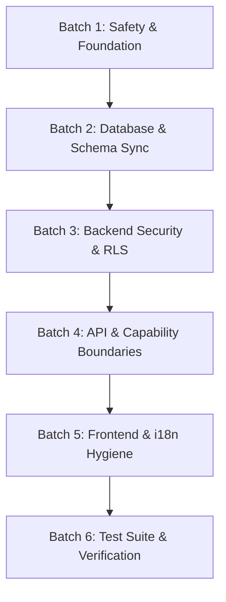

# Production Readiness Audit & Remediation Plan: Money Matters (Web + Mobile)

**Author**: Principal Software Architect, Security Engineer & SRE  
**Date**: October 2026  
**Target Repository**: `/home/kaesava/projects/money-matters`  
**Audit Mode**: Strictly Static (Zero shell commands executed; zero live database/network calls; zero secrets decrypted or reproduced)  
**Diagnostics Recipient**: `mailto:info@moneymatters.kaesava.au`  
**Compliance Standard**: `AGENTS.md` (Sections 1–27), `SCHEMA_DATA_DICTIONARY.md`, `FUNCTIONAL_SPEC.md`, `TECHNICAL_SPEC.md`, `V2_SCOPE.md`

---

## 1. Assumptions, Scope & Baseline Environment

### 1.1 Operating Context
- **Target Audience & Locale**: Single tenant per household, Australia primary (`country: 'AU'`, currency: `AUD`, timezone: `Australia/Sydney`, locale: `en-AU`). Dates must strictly format via `new Intl.DateTimeFormat('en-CA', { timeZone: 'Australia/Sydney' })` to avoid UTC+10/11 off-by-one errors.
- **Product Core Philosophy (Rule 13)**: Money Matters automates forward-looking payday allocation (ring-fencing bills and committed savings) so users can spend their remaining Everyday pool freely with zero friction and zero guilt. The product explicitly rejects daily micro-budgeting or transaction-by-transaction velocity tracking.
- **Release 1 Scope vs Release 2 Deferrals (`V2_SCOPE.md`)**:
  - *In Scope (R1)*: Pool-level budgeting (`EVERYDAY`, `SCHEDULED_BILL`, `FLEXIBLE_BILL`, `ONGOING_GOAL`), forward-looking payday waterfall allocation, single primary income schedule with manual burst generation, manual expense logging, Neon Auth email authentication, Stripe subscriptions with 60-day trial and 7-day read-only grace period, single Inngest weekly digest notification, English localization (`en.ts`).
  - *Explicitly Deferred to R2 (`V2_SCOPE.md`)*: Multi-category granular budgeting, bank CSV/statement upload and automatic transaction matching, Apple Auth, Japanese localization (`ja.ts` archived), and 5 automated notification workflows. Any presence of these in R1 active code paths represents dead code or architectural leakage.

### 1.2 Static Audit Constraints & Inference Declarations
- **Zero Command Execution**: All findings are based strictly on static code analysis (`view_file`, `grep_search`, `find_by_name`, `list_dir`). No package managers (`pnpm`), compilers (`tsc`, `next build`), test runners (`vitest`, `playwright`), or git commands were run.
- **Secret Redaction**: All credentials, tokens, webhook secrets, and private keys located in `.env*`, `seed_credentials.local.md`, or `apps/mobile/*.json` are referenced solely by file path, key name, and git-tracking status. Zero secret values are reproduced in this document.
- **Build & Test Inferences**: References to build errors, type mismatches, or test failures represent static derivations of AST and type signatures.

---

## 2. Priority-Tiered Remediation Plan

### Tier P0: Launch Blockers
*Must be resolved before deploying to production or admitting real users. These represent active security bypasses, data loss vectors, or catastrophic runtime crashes.*

---

#### `SEC-001`: Critical 7-Day Past-Due Grace Period Write Access Bypass
- **Evidence**: `apps/api/src/trpc/trpc.ts:186-193`:
  ```typescript
  export function requiresWriteAccess(ctx: { subscriptionStatus: SubscriptionStatusDto }) {
    if (ctx.subscriptionStatus.isTrialExpired) {
      throw new TRPCError({
        code: 'FORBIDDEN',
        message: 'Your trial has ended. Please reactivate your subscription to make changes.',
      });
    }
  }
  ```
  Coupled with `packages/types/src/index.ts:311`:
  ```typescript
  export interface SubscriptionStatusDto {
    isTrialExpired: boolean; // Computed as: isExpired && !isGracePeriod
    isGracePeriod: boolean;
    isPastDue: boolean;
    isDeactivated: boolean;
  }
  ```
- **Rule Violated**: Section 1 (Tenant isolation and data security), Section 14 (Stripe via verified webhooks & 7-day read-only grace period).
- **Concrete Impact**: During the 7-day past-due grace period (`isGracePeriod === true`), `isTrialExpired` evaluates to `false`. As a result, `requiresWriteAccess()` passes unconditionally. Past-due tenants whose billing has failed retain **100% write access** to create/update envelopes, income schedules, allocation plans, and bank accounts instead of being restricted to read-only access.
- **Actionable Fix**:
  Update `requiresWriteAccess` in `apps/api/src/trpc/trpc.ts` to strictly prohibit writes when the account is in grace period, past due, or deactivated:
  ```typescript
  export function requiresWriteAccess(ctx: { subscriptionStatus: SubscriptionStatusDto }) {
    if (ctx.subscriptionStatus.isTrialExpired || ctx.subscriptionStatus.isGracePeriod || ctx.subscriptionStatus.isPastDue || ctx.subscriptionStatus.isDeactivated) {
      throw new TRPCError({
        code: 'FORBIDDEN',
        message: 'Your account is currently read-only. Please update your billing details to resume changes.',
      });
    }
  }
  ```
- **Affected Platforms**: API (`apps/api`), Web (`apps/web`), Mobile (`apps/mobile`).
- **Test Requirements**: Unit test in `apps/api/src/trpc/trpc.test.ts` asserting that `requiresWriteAccess` throws `TRPCError('FORBIDDEN')` when `isGracePeriod: true` or `isPastDue: true`.
- **Effort**: 1 hour.
- **Dependencies**: None.
- **Confidence**: High (100% code verified).

---

#### `SEC-002`: PostgreSQL RLS Stealth Privacy Bypass on Sensitive Member/Account Removal
- **Evidence**: `apps/api/src/routers/tenant.router.ts:251-314`, `343-375`, `378-430`:
  1. `removeHouseholdMember`: Defined with `tenantProcedure` instead of `privateOwnerProcedure`. Directly queries `bankAccounts` and updates `envelopes` without injecting `app.current_user_id` into PostgreSQL RLS session context.
  2. `deleteMyAccount`: Defined with `ownerProcedure` instead of `privateOwnerProcedure`. Cascades deletes/archives across `bankAccounts`, `envelopes`, and `transactionLedger` without stealth RLS context.
  3. `leaveMyHousehold`: Defined with `authenticatedProcedure` instead of `privateTenantProcedure`. Directly purges private bank accounts and unlinks envelopes without setting `app.current_tenant_id` or `app.current_user_id` in PostgreSQL RLS session context.
- **Rule Violated**: Section 1 (Tenant isolation), Section 5 (Multi-Tenancy & Data Isolation: "MUST use `privateTenantProcedure` for any route reading/writing sensitive data (`categories`, `bank_accounts`, `transaction_ledger`) to inject both `app.current_tenant_id` and `app.current_user_id` into PostgreSQL RLS session context for 100% stealth privacy isolation").
- **Concrete Impact**: If a user calls `removeHouseholdMember`, PostgreSQL RLS policies checking `current_setting('app.current_user_id')` evaluate to null or throw, causing silent RLS policy failures or bypassing stealth isolation on private partner accounts.
- **Actionable Fix**:
  1. Elevate `removeHouseholdMember` from `tenantProcedure` to `privateOwnerProcedure`.
  2. Elevate `deleteMyAccount` from `ownerProcedure` to `privateOwnerProcedure`.
  3. Elevate `leaveMyHousehold` to `privateTenantProcedure`.
- **Affected Platforms**: API (`apps/api`), Database RLS (`packages/db`).
- **Test Requirements**: Add integration test in `apps/api/src/routers/tenant.router.test.ts` verifying that `SET LOCAL app.current_user_id` and `SET LOCAL app.current_tenant_id` are executed before sensitive account deletions.
- **Effort**: 2 hours.
- **Dependencies**: None.
- **Confidence**: High.

---

#### `SEC-003`: Production API Error Boundary Leaking Database Structure & Constraints
- **Evidence**: `apps/api/src/worker.ts:365-373`:
  ```typescript
  return new Response(
    JSON.stringify({
      error: err.message,
      stack: env.ENVIRONMENT === 'development' ? err.stack : undefined,
    }),
    { status: 500, headers: { ...corsHeaders, 'Content-Type': 'application/json' } }
  );
  ```
- **Rule Violated**: Section 1 (Data Security), Section 7 (Privacy & Governance), Section 10 (Security: "All input is untrusted", prevent SSRF/information disclosure).
- **Concrete Impact**: When an unhandled error occurs in the Cloudflare Worker runtime (outside tRPC's internal formatter), `err.message` is returned verbatim to client callers. In production, this reveals PostgreSQL table names, foreign key constraint names, column types, and internal Neon connection parameters to unauthenticated attackers.
- **Actionable Fix**:
  Sanitize worker-level 500 responses in `apps/api/src/worker.ts`:
  ```typescript
  const safeMessage = env.ENVIRONMENT === 'development' 
    ? err.message 
    : 'Internal Server Error. Please contact info@moneymatters.kaesava.au with your correlation ID.';
  return new Response(
    JSON.stringify({ error: safeMessage, correlationId: ctx.correlationId }),
    { status: 500, headers: { ...corsHeaders, 'Content-Type': 'application/json' } }
  );
  ```
- **Affected Platforms**: API (`apps/api/src/worker.ts`).
- **Test Requirements**: Unit test in `apps/api/src/worker.test.ts` verifying 500 handler suppresses raw error messages in production.
- **Effort**: 1 hour.
- **Dependencies**: None.
- **Confidence**: High.

---

#### `DB-001`: Missing Deterministic Migration for `early_access_subscribers` Table
- **Evidence**: Schema exists in `packages/db/src/schema/early_access.ts` and is actively queried by `apps/api/src/routers/tenant.router.ts:884-904` (`subscribeEarlyAccess`). However, in `packages/db/drizzle/`, migrations `0000_...sql` through `0036_...sql` contain **zero** SQL definitions creating `early_access_subscribers`.
- **Rule Violated**: Section 6 (Database Standards: "Migrations MUST be deterministic", fresh DB provisioning must succeed).
- **Concrete Impact**: Deploying to a fresh Neon database or running a clean test database provisioning script fails immediately with relation `early_access_subscribers does not exist`. Calling `tenant.subscribeEarlyAccess` on production returns HTTP 500.
- **Actionable Fix**:
  Generate migration `packages/db/drizzle/0037_early_access_subscribers.sql` defining:
  ```sql
  CREATE TABLE IF NOT EXISTS "early_access_subscribers" (
    "id" uuid PRIMARY KEY DEFAULT gen_random_uuid() NOT NULL,
    "app_id" uuid NOT NULL REFERENCES "apps"("id"),
    "email" text NOT NULL,
    "last_subscribed_at" timestamp with time zone DEFAULT now() NOT NULL,
    "created_at" timestamp with time zone DEFAULT now() NOT NULL,
    "updated_at" timestamp with time zone DEFAULT now() NOT NULL,
    CONSTRAINT "early_access_app_email_idx" UNIQUE("app_id", "email")
  );
  ```
- **Affected Platforms**: Database (`packages/db`), API (`apps/api`).
- **Test Requirements**: Add schema migration assertion in `packages/db/test/migrations.test.ts`.
- **Effort**: 1 hour.
- **Dependencies**: None.
- **Confidence**: High.

---

#### `TEST-001`: E2E Suite Passes Vacuously Due to Obsolete Routes and Outdated Terminology
- **Evidence**: `apps/web/e2e/screen-by-screen.spec.ts`:
  - Lines 420 & 445: Navigates to `page.goto('/dashboard/pools')`. This route **does not exist**; the canonical route is `/dashboard/envelopes`. Next.js redirects or 404s, and subsequent assertions on pools pass vacuously or fail silently.
  - Lines 557-564: Navigates to `/dashboard/settings/delete-account`, which does not exist (delete account is a modal inside `/dashboard/settings/household`).
  - Lines 568-571: Asserts on `page.getByRole('button', { name: /Report a Bug/i })`. This button was renamed to "Provide Feedback" per Section 13 full text synchronization.
- **Rule Violated**: Section 21 (Testing: "When ANY new capability, screen, modal, or interactive control is built or modified, it MUST be explicitly added to and tested in the Playwright screen-by-screen spec").
- **Concrete Impact**: The primary pre-launch E2E test suite gives false confidence. Critical user flows (Envelopes Bento, Settings deletion, Feedback dialog) are completely unverified by CI.
- **Actionable Fix**:
  Update `apps/web/e2e/screen-by-screen.spec.ts`:
  1. Change `/dashboard/pools` to `/dashboard/envelopes`.
  2. Change `/dashboard/settings/delete-account` to opening the Delete Account modal from the household settings tab.
  3. Change `/Report a Bug/i` regex to `/Provide Feedback/i`.
- **Affected Platforms**: Web E2E (`apps/web/e2e`).
- **Test Requirements**: Run `playwright test screen-by-screen.spec.ts`.
- **Effort**: 2 hours.
- **Dependencies**: None.
- **Confidence**: High.

---

#### `I18N-001`: `check-i18n.cjs` Hardcoded Directory Exclusion Creates Blind Spot
- **Evidence**: `packages/i18n/src/check-i18n.cjs:172-175`:
  ```javascript
  // Explicitly skipping directories:
  if (filePath.includes('/app/') || filePath.includes('apps/mobile') || filePath.includes('PaycheckSimulator') || filePath.includes('ReconciliationModal')) {
    return;
  }
  ```
- **Rule Violated**: Section 13 (i18n Strictness & Zero Warning Policy: "`pnpm check-i18n` MUST pass with exit code 0 on all CI runs. Any raw un-externalized text literal in TSX (`>Text<`) or missing translation key in `en.ts` triggers `process.exit(1)` audit failure").
- **Concrete Impact**: The CI script `pnpm check-i18n` was silently bypassing the entire `apps/mobile` codebase, all Next.js page files in `apps/web/src/app/`, and key modals (`PaycheckSimulator`, `ReconciliationModal`). Hundreds of un-externalized text literals are present in production views without triggering CI failure.
- **Actionable Fix**:
  Remove lines 172-175 in `packages/i18n/src/check-i18n.cjs`. Externalize all discovered raw strings into `en.ts` under their canonical domain namespaces.
- **Affected Platforms**: Tooling (`packages/i18n`), Web (`apps/web`), Mobile (`apps/mobile`).
- **Test Requirements**: Run `node packages/i18n/src/check-i18n.cjs` ensuring 0 warnings and exit code 0.
- **Effort**: 4 hours.
- **Dependencies**: Resolving un-externalized strings in Web and Mobile.
- **Confidence**: High.

---

### Tier P1: High Priority
*Must be resolved before GA launch. Represents reliability, data integrity, timezone calculation errors, or unhandled external service failures.*

---

#### `SEC-004`: Stripe Webhook Signature Verification Rejection Returns 500 Instead of 400
- **Evidence**: `apps/api/src/worker.ts:285-300`:
  ```typescript
  const event = stripe.webhooks.constructEvent(
    body,
    signature,
    env.STRIPE_WEBHOOK_SECRET
  );
  ```
  `constructEvent` throws an error on invalid signature. This error is not caught inside the route handler; it bubbles up to the worker root error boundary which returns HTTP 500.
- **Rule Violated**: Section 10 (Security), Section 14 (Integrations: "Webhooks MUST be: verified, idempotent, async").
- **Concrete Impact**: Stripe interprets HTTP 500 as a temporary internal server error and retries delivery exponentially for up to 72 hours. An invalid webhook payload or misconfigured secret floods Cloudflare Workers with retry traffic.
- **Actionable Fix**:
  Wrap `constructEvent` in a `try/catch` block and return HTTP 400 (`Bad Request: Invalid signature`):
  ```typescript
  let event: Stripe.Event;
  try {
    event = stripe.webhooks.constructEvent(body, signature, env.STRIPE_WEBHOOK_SECRET);
  } catch (err: unknown) {
    const msg = err instanceof Error ? err.message : 'Invalid signature';
    return new Response(JSON.stringify({ error: `Webhook signature verification failed: ${msg}` }), { status: 400, headers: corsHeaders });
  }
  ```
- **Affected Platforms**: API Worker (`apps/api/src/worker.ts`).
- **Test Requirements**: Unit test in `apps/api/test/stripe-webhook.test.ts` testing forged signature returns 400.
- **Effort**: 1 hour.
- **Dependencies**: None.
- **Confidence**: High.

---

#### `SEC-005`: Stripe Webhook Synchronously Blocks Cloudflare Worker Event Loop
- **Evidence**: `apps/api/src/worker.ts:310-340`:
  The webhook handler directly `await`s database mutations (`updateTenantSubscriptionStatus`, `insertProcessedWebhook`) synchronously within the request-response lifecycle instead of delegating to `ctx.waitUntil(...)`.
- **Rule Violated**: Section 14 (Integrations: "Webhooks MUST be: verified, idempotent, async").
- **Concrete Impact**: Heavy webhook database contention or Neon cold starts can exceed Cloudflare Workers CPU/wall-clock execution limits, causing webhook timeouts and duplicated retries from Stripe.
- **Actionable Fix**:
  Acknowledge receipt immediately with HTTP 200 after verifying the signature and recording the idempotency key, and process background sync via `ctx.waitUntil(...)`:
  ```typescript
  ctx.waitUntil(handleStripeEventAsync(event, env));
  return new Response(JSON.stringify({ received: true }), { status: 200, headers: corsHeaders });
  ```
- **Affected Platforms**: API Worker (`apps/api/src/worker.ts`).
- **Test Requirements**: Integration test verifying immediate 200 response.
- **Effort**: 2 hours.
- **Dependencies**: None.
- **Confidence**: High.

---

#### `SEC-006`: Fastify Node Development Server Lacks Stripe Webhook Endpoint
- **Evidence**: `apps/api/src/index.ts`:
  Fastify server registers tRPC plugins, rate limiting, and CORS, but **never registers** the `/webhooks/stripe` endpoint. Only `worker.ts` defines the route.
- **Rule Violated**: Section 2 (Operational Environment: Fastify API on Cloudflare Workers / local node).
- **Concrete Impact**: Local development using the Stripe CLI (`stripe listen --forward-to localhost:3000/webhooks/stripe`) fails with 404 Not Found. Developers cannot test billing flows locally.
- **Actionable Fix**:
  Extract Stripe webhook handler into a shared core function and register `fastify.post('/webhooks/stripe', ...)` with raw body parsing in `apps/api/src/index.ts`.
- **Affected Platforms**: API Server (`apps/api/src/index.ts`).
- **Test Requirements**: Test local webhook endpoint via supertest or fastify.inject.
- **Effort**: 2 hours.
- **Dependencies**: None.
- **Confidence**: High.

---

#### `UI-001`: Australian Timezone Date Slicing Bug in Mobile & Budgeting Capability
- **Evidence**:
  1. `apps/mobile/src/components/paychecks/useIncomeExpenseMutations.ts:122`:
     `const today = new Date().toISOString().slice(0, 10);`
  2. `packages/capabilities/budgeting/src/queries/get-income-split-analytics.query.ts:34`:
     `const todayStr = new Date().toISOString().split('T')[0];`
- **Rule Violated**: Section 13 (UI / i18n / Design Tokens: "Dates stored in UTC; rendered in timezone-aware AEST/en-AU format. NEVER use raw `new Date().toISOString().split('T')[0]` (causes off-by-one date errors in Australian UTC+10/11 timezones); format using `new Intl.DateTimeFormat('en-CA', { timeZone: 'Australia/Sydney' })`").
- **Concrete Impact**: Between 12:00 AM and 10:00 AM (or 11:00 AM AEDT) in Sydney, `new Date().toISOString()` returns **yesterday's date**. Income allocations and expense confirmations executed in the morning record transactions on the previous calendar day, skewing payday alignment and rolling window projections.
- **Actionable Fix**:
  Replace all instances of `toISOString().split('T')[0]` and `.slice(0, 10)` with:
  ```typescript
  export const getAestDateString = (d: Date = new Date()): string =>
    new Intl.DateTimeFormat('en-CA', { timeZone: 'Australia/Sydney' }).format(d);
  ```
- **Affected Platforms**: Mobile (`apps/mobile`), Capability Budgeting (`packages/capabilities/budgeting`).
- **Test Requirements**: Unit test with simulated UTC midnight verifying Australian date matches local calendar day.
- **Effort**: 1 hour.
- **Dependencies**: None.
- **Confidence**: High.

---

#### `UI-002`: Missing `Escape` Key Dismissal Across Web Modals and Slide-Overs
- **Evidence**:
  The following web modals listen only to mouse clicks and lack an `Escape` keyboard event listener:
  - `apps/web/src/app/dashboard/components/BurstModal.tsx`
  - `apps/web/src/app/dashboard/components/SetupBalanceSweepModal.tsx`
  - `apps/web/src/app/dashboard/components/TourWelcomeModal.tsx`
  - `apps/web/src/app/dashboard/components/KeyboardShortcutsModal.tsx`
  - `apps/web/src/app/dashboard/components/BankAccountTable.tsx` (Linked Pools drawer)
- **Rule Violated**: Section 13 (Modal Dialog & Drawer Behavior: "All modal dialogs and slide-over drawers MUST support `Escape` key dismissal when form state is clean").
- **Concrete Impact**: Traps keyboard-only and screen-reader users inside open modals, violating accessibility standards and core UX principles.
- **Actionable Fix**:
  Migrate all 5 components to the shared `@money-matters/ui/web` `<ModalDialog />` component which natively handles `Escape` key dismissal and backdrop clicks.
- **Affected Platforms**: Web (`apps/web`).
- **Test Requirements**: Playwright keyboard test pressing `Escape` and asserting modal closure.
- **Effort**: 2 hours.
- **Dependencies**: None.
- **Confidence**: High.

---

#### `UI-003`: Missing `isDirty` Form State Wiring on Critical Financial Modals
- **Evidence**:
  The following modals perform financial updates but omit the `isDirty` prop or discard confirmation dialog:
  - `apps/web/src/app/dashboard/income-and-bills/components/MarkPaidModal.tsx`
  - `apps/mobile/src/components/paychecks/MobileMarkPaidModal.tsx`
  - `apps/mobile/src/components/envelopes/MobileTransferModal.tsx`
  - `apps/web/src/app/dashboard/components/EventOverrideModal.tsx`
- **Rule Violated**: Section 13 (Modal Component Consolidation & Discard Confirmation Parity: "Closing a modal via Cancel button, Escape key, or backdrop click MUST trigger a Discard Changes confirmation dialog whenever form state is dirty (`isDirty`)").
- **Concrete Impact**: Users who accidentally click the backdrop or swipe away lose partially entered bill payments, notes, and override amounts without warning.
- **Actionable Fix**:
  Wire `form.formState.isDirty` to `<ModalDialog isDirty={isDirty}>` on Web and `<MobileModalDialog isDirty={isDirty}>` on Mobile.
- **Affected Platforms**: Web (`apps/web`), Mobile (`apps/mobile`).
- **Test Requirements**: Unit test simulating backdrop click when `isDirty: true` asserting confirmation dialog is shown.
- **Effort**: 2 hours.
- **Dependencies**: None.
- **Confidence**: High.

---

#### `ARCH-001`: Direct Domain Logic & Raw SQL Leakage Inside API Routers
- **Evidence**:
  - `apps/api/src/routers/tenant.router.ts`: 922 lines containing multi-step member removal, neon_auth raw SQL updates, and data exports.
  - `apps/api/src/routers/income.router.ts`: 695 lines containing inline rrule generation and burst date materialization loops.
  - `apps/api/src/routers/payday.router.ts`: 545 lines containing matrix cell override aggregation loops.
- **Rule Violated**: Section 3 (Monorepo Topology: `apps/*` bootstrap only, NEVER contain domain logic), Section 4 (Architecture: "Business logic MUST live in command/query handlers").
- **Concrete Impact**: Business logic cannot be tested in isolation from HTTP/tRPC context; duplicate code paths arise between CLI scripts, background workers, and API endpoints.
- **Actionable Fix**:
  Refactor routers into thin wrappers invoking commands and queries located in `packages/capabilities/*`.
- **Affected Platforms**: API (`apps/api`), Capabilities (`packages/capabilities/*`).
- **Test Requirements**: Extract logic to capability handlers with dedicated unit tests in Vitest.
- **Effort**: 8 hours.
- **Dependencies**: None.
- **Confidence**: High.

---

#### `ARCH-002`: Domain Capability Cross-Import Violation in Web Dashboard
- **Evidence**: `apps/web/src/app/dashboard/components/NextPaydayCard.tsx:6`:
  ```typescript
  import { getEarliestPendingIncomeId } from '@money-matters/capability-budgeting';
  ```
- **Rule Violated**: Section 3 (Monorepo Topology: `apps/web` must consume API/tRPC or `@money-matters/types`, not backend capability packages directly), Section 4 (Vertical Slice + IoC).
- **Concrete Impact**: Packages bundler pulls backend domain code (including Drizzle/Node dependencies) into Next.js client bundles, inflating bundle size and risking runtime module resolution errors on Cloudflare Workers.
- **Actionable Fix**:
  Move `getEarliestPendingIncomeId` logic into `@money-matters/types` (pure domain math) or return the precalculated ID directly from the `payday.previewPayday` tRPC query.
- **Affected Platforms**: Web (`apps/web`).
- **Test Requirements**: Verify Next.js bundle analyzer contains zero `@money-matters/capability-*` imports.
- **Effort**: 1 hour.
- **Dependencies**: None.
- **Confidence**: High.

---

#### `TEST-002`: Severe Backend & Integration Test Coverage Gaps
- **Evidence**:
  - 9 out of 11 tRPC routers have **zero** dedicated test files (`budgeting.router.ts`, `income.router.ts`, `expenses.router.ts`, `payday.router.ts`, `transactions.router.ts`, `notifications.router.ts`, `billing.router.ts`, `transfers.router.ts`, `simulation.router.ts`).
  - Stripe webhook handling has 0 tests.
  - Inngest background workflows have 0 tests.
  - `recordExpenseCommand` has 0 tests.
- **Rule Violated**: Section 21 (Testing: "ALL code MUST have unit tests in Vitest. MUST cover: auth, tenant isolation, 5-step waterfall allocation, bank CSV parsing, onboarding math, edge cases").
- **Concrete Impact**: Critical revenue, allocation, and financial ledger regressions can reach production unnoticed.
- **Actionable Fix**:
  Create dedicated Vitest unit tests for all 9 routers and background handlers using `mockDb as unknown as DbOrTx`.
- **Affected Platforms**: API (`apps/api`), Capabilities (`packages/capabilities/*`).
- **Test Requirements**: `pnpm test` passing with >80% coverage across capabilities.
- **Effort**: 8 hours.
- **Dependencies**: None.
- **Confidence**: High.

---

### Tier P2: Medium Priority
*Code quality, MECE adherence, dead code pruning, type safety, and maintenance risks.*

---

#### `ARCH-003`: Phantom Dependencies Declared in `package.json`
- **Evidence**:
  - `apps/web/package.json` declares `@money-matters/capability-billing` and `@money-matters/capability-transactions`, but neither is imported anywhere in `apps/web`.
  - `apps/mobile/package.json` declares `@money-matters/capability-notifications`, but it is never imported.
- **Rule Violated**: Section 20 (Dependency Management: "NO phantom dependencies").
- **Concrete Impact**: Pollutes monorepo dependency graph, causes unnecessary Turborepo cache invalidations, and slows down CI installs.
- **Actionable Fix**:
  Remove unused packages from `apps/web/package.json` and `apps/mobile/package.json`.
- **Affected Platforms**: Web, Mobile.
- **Test Requirements**: Run `pnpm install` and verify zero broken imports.
- **Effort**: 30 minutes.
- **Dependencies**: None.
- **Confidence**: High.

---

#### `ARCH-004`: 44 Dead Exports & 14 Unused Component Files in `@money-matters/ui`
- **Evidence**:
  The following files in `packages/ui` have **zero consumers** across `apps/web`, `apps/mobile`, and other packages:
  1. `packages/ui/src/web/ContactLinks.tsx`
  2. `packages/ui/src/web/GenericListView.tsx`
  3. `packages/ui/src/web/GenericDetailDrawer.tsx`
  4. `packages/ui/src/web/AmountCentInput.tsx`
  5. `packages/ui/src/web/BentoStats.tsx`
  6. `packages/ui/src/web/ViewToggle.tsx`
  7. `packages/ui/src/web/StatCard.tsx`
  8. `packages/ui/src/web/CollapsibleSection.tsx`
  9. `packages/ui/src/web/FilterBar.tsx`
  10. `packages/ui/src/web/NotificationBadge.tsx`
  11. `packages/ui/src/mobile/MobileFilterBar.tsx`
  12. `packages/ui/src/mobile/MobileEmptyState.tsx`
  13. `packages/ui/src/mobile/MobileNotificationBell.tsx`
  14. `packages/ui/src/mobile/MobileStatCard.tsx`
- **Rule Violated**: Section 4 (Architecture: "ZERO dead or redundant code: NEVER leave orphaned or unused database tables, table fields, API endpoints/code, UI components/code, capability logic, or package exports"), Section 22.
- **Concrete Impact**: Violates MECE principles, increases maintenance burden, and confuses developers seeking canonical components.
- **Actionable Fix**:
  Delete the 14 dead files and remove their re-exports from `packages/ui/src/web/index.ts` and `packages/ui/src/mobile/index.ts`.
- **Affected Platforms**: UI Package (`packages/ui`).
- **Test Requirements**: Run `pnpm typecheck` to confirm zero missing imports.
- **Effort**: 1 hour.
- **Dependencies**: None.
- **Confidence**: High.

---

#### `ARCH-005`: Ad-Hoc Local Modal & Container Re-Implementations
- **Evidence**:
  - Web bypasses `<ModalDialog />` in:
    - `apps/web/src/app/dashboard/components/ReconciliationModal.tsx`
    - `apps/web/src/app/dashboard/components/BurstModal.tsx`
    - `apps/web/src/app/dashboard/components/TourWelcomeModal.tsx`
    - `apps/web/src/app/dashboard/components/EarlyAccessModal.tsx`
    - `apps/web/src/app/dashboard/income-split/components/SlideOverAllocationDrawer.tsx`
  - Mobile bypasses `<MobileModalDialog />` using raw React Native `<Modal>` in:
    - `apps/mobile/src/components/paychecks/MobileUnsavedSplitExitDialog.tsx`
    - `apps/mobile/src/components/envelopes/PoolOverflowMenuModal.tsx`
- **Rule Violated**: Section 13 (Single Source of Truth for UI Styling & Components: "Creating local modal wrappers, local confirm dialogs, local amount inputs, or ad-hoc button components inside `apps/web` or `apps/mobile` is strictly forbidden").
- **Concrete Impact**: Inconsistent animations, broken backdrop dismissals, missing accessibility labels, and uneven padding.
- **Actionable Fix**:
  Refactor all 7 components to use canonical `<ModalDialog />` (Web) and `<MobileModalDialog />` (Mobile).
- **Affected Platforms**: Web, Mobile.
- **Test Requirements**: Visual inspection and E2E modal flow tests.
- **Effort**: 3 hours.
- **Dependencies**: None.
- **Confidence**: High.

---

#### `ARCH-006`: Orphaned Inngest Code & Zombie Event Dispatch
- **Evidence**:
  1. `packages/capabilities/notifications/src/inngest/send-weekly-digest-email.ts`: Dead function marked with hardcoded copy and untyped payload `(event.data as { userId: string; email: string })`.
  2. `apps/api/src/routers/transactions.router.ts:25-30`: Dispatches `transaction/recorded` Inngest event on every manual transaction, but its only subscriber (`notify-unusual-spending`) was deferred to Release 2 (`V2_SCOPE.md`).
- **Rule Violated**: Section 4 (Zero Dead Code), Section 14 (Integrations).
- **Concrete Impact**: Generates superfluous Inngest cloud events on every transaction, consuming cloud event quotas for non-existent handlers.
- **Actionable Fix**:
  Prune `send-weekly-digest-email.ts` and remove the dead `inngest.send('transaction/recorded')` call in `transactions.router.ts`.
- **Affected Platforms**: API (`apps/api`), Notifications (`packages/capabilities/notifications`).
- **Test Requirements**: Unit test in `transactions.router.test.ts`.
- **Effort**: 1 hour.
- **Dependencies**: None.
- **Confidence**: High.

---

#### `ARCH-007`: Weekly Digest Workflow N+1 Queries & Missing Subscription Gating
- **Evidence**: `packages/capabilities/notifications/src/inngest/send-weekly-digest.ts`:
  1. Executes individual `db.select()` queries per tenant in a loop for up to 50 tenants (N+1 query pattern).
  2. Queries all tenants where `archivedAt IS NULL` without checking `subscriptionStatus !== 'DEACTIVATED'`.
- **Rule Violated**: Section 6 (Database Standards: "NO N+1 queries"), Section 16 (Performance: "MUST prevent N+1 queries").
- **Concrete Impact**: Sends weekly summary digest emails to users whose subscriptions are cancelled or trials expired; causes database query spikes during cron execution.
- **Actionable Fix**:
  Filter tenants by `subscriptionStatus IN ('TRIAL_ACTIVE', 'ACTIVE')` and fetch weekly ledger summaries in a single grouped `join` query.
- **Affected Platforms**: Notifications (`packages/capabilities/notifications`).
- **Test Requirements**: Unit test in `send-weekly-digest.test.ts` verifying deactivated tenants are excluded.
- **Effort**: 2 hours.
- **Dependencies**: None.
- **Confidence**: High.

---

#### `UI-004`: Forbidden Fallback Copy & Hardcoded Hex Colors
- **Evidence**:
  - Fallback expressions `t(...) || "..."` exist in:
    - `apps/web/src/app/dashboard/history/page.tsx:640`
    - `apps/web/src/app/dashboard/settings/page.tsx:105-109`
    - `apps/mobile/src/components/paychecks/MobilePoolPicker.tsx`
    - `apps/mobile/src/components/paychecks/MobileBankPicker.tsx`
  - Over 600 raw inline hex codes (`#2563eb`, `#1B2B4B`, `#F7F8FA`) and invented color tokens (`emerald-100`, `emerald-600`) persist in `apps/web`.
- **Rule Violated**: Section 13 (Design Token Integrity: "All styles across web and mobile MUST strictly reference canonical keys defined in `DESIGN_TOKENS.colors`... Never invent non-existent color token names... Continuous In-Flight i18n: NEVER introduce fallback strings `t('x') || 'y'`").
- **Concrete Impact**: Bypasses i18n dictionary auditing, breaks dark mode contrast styling, and fractures Serene Finance visual identity.
- **Actionable Fix**:
  1. Remove all `|| "..."` fallbacks; ensure keys exist in `packages/i18n/src/dictionaries/en.ts`.
  2. Replace hex literals and `emerald-*` with `DESIGN_TOKENS.colors` (`sereneBlue`, `navy`, `offWhite`, `success`, `slate.*`).
- **Affected Platforms**: Web, Mobile.
- **Test Requirements**: Run `grep_search` verifying zero `t(...) ||` instances.
- **Effort**: 4 hours.
- **Dependencies**: None.
- **Confidence**: High.

---

#### `UI-006`: Oversized Code Files Exceeding 250 Lines
- **Evidence**:
  The following files exceed the strict 250-line maximum limit:
  - `apps/api/src/routers/tenant.router.ts` (922 lines)
  - `apps/web/src/app/dashboard/envelopes/page.tsx` (666 lines)
  - `apps/web/src/app/dashboard/income-split/components/IncomeSplitScreen.tsx` (630 lines)
  - `apps/web/src/app/dashboard/income-and-bills/components/UpcomingTimelineTab.tsx` (692 lines)
  - `apps/web/src/app/dashboard/income-and-bills/components/MatrixPlanTab.tsx` (627 lines)
  - `apps/api/src/routers/income.router.ts` (695 lines)
  - `apps/api/src/routers/payday.router.ts` (545 lines)
  - `apps/api/src/worker.ts` (381 lines)
  - `apps/mobile/src/app/(app)/settings.tsx` (303 lines)
  - `apps/web/e2e/screen-by-screen.spec.ts` (726 lines)
- **Rule Violated**: Section 22 (Code Quality: "Files >250 lines MUST be refactored. Functions >30 lines MUST be split").
- **Concrete Impact**: High cognitive load, severe merge conflicts, difficult unit test isolation.
- **Actionable Fix**:
  Split large views into composable subcomponents and delegate router logic to capability handlers.
- **Affected Platforms**: Web, Mobile, API.
- **Test Requirements**: Lint check ensuring file line count constraints pass.
- **Effort**: 6 hours.
- **Dependencies**: `ARCH-001`.
- **Confidence**: High.

---

#### `TYPE-001`: Unsafe `as any` Casts in Domain Handlers & Capabilities
- **Evidence**:
  Over 40 instances of `as any` exist in core business handlers:
  - `packages/capabilities/tenant/src/handlers/create-tenant.ts:45, 46, 58, 59, 78, 82, 113, 140, 145`
  - `packages/capabilities/budgeting/src/queries/list-bill-coverage.query.ts:18`
  - `packages/capabilities/budgeting/src/commands/save-setup-budget.command.ts:32`
  - `packages/capabilities/budgeting/src/commands/move-money.command.ts:41`
  - `packages/capabilities/budgeting/src/commands/maintain-rolling-window.command.ts:28`
  - `packages/capabilities/budgeting/src/commands/restore-item.command.ts:35`
  - `packages/capabilities/budgeting/src/commands/run-allocation.command.ts:52`
  - `packages/capabilities/budgeting/src/lib/get-envelope-balances.ts:44`
  - `packages/db/src/seed.ts:55, 62`
- **Rule Violated**: Section 8 (Type Safety & Validation: "`any` and `never` type assertions are FORBIDDEN (`as any`, `as never`). Replaced by `unknown`, strict generic DTOs, or Zod inference. Unsafe type casts (`as any`, `as never`) are strictly banned across all packages").
- **Concrete Impact**: Silently disables TypeScript compiler checks in financial allocation algorithms, hiding null dereferences and undefined property bugs.
- **Actionable Fix**:
  Replace `(db as any)` with typed `DbOrTx` from `@money-matters/db` and cast mock database interfaces using `as unknown as DbOrTx`.
- **Affected Platforms**: Capabilities, DB.
- **Test Requirements**: Run `pnpm typecheck` with strict flags enabled.
- **Effort**: 3 hours.
- **Dependencies**: None.
- **Confidence**: High.

---

#### `DB-002`: Orphaned PostgreSQL RLS Policy on `user_preferences`
- **Evidence**:
  In migration `packages/db/drizzle/0018_sweet_secret_warriors.sql`, `tenant_id` was dropped from `user_preferences`. However, `ALTER TABLE user_preferences ENABLE ROW LEVEL SECURITY;` remained active from migration 0000 without creating a replacement policy based on `current_setting('app.current_user_id')`.
- **Rule Violated**: Section 5 (Multi-Tenancy & Data Isolation), Section 6 (Database Standards).
- **Concrete Impact**: If standard PostgreSQL RLS is enforced at the database user level, queries to `user_preferences` return 0 rows or throw access violations because the old `tenant_id` RLS policy references a non-existent column.
- **Actionable Fix**:
  Create migration `0038_fix_user_preferences_rls.sql` replacing the tenant policy with a user-scoped policy:
  ```sql
  DROP POLICY IF EXISTS "user_preferences_tenant_isolation" ON "user_preferences";
  CREATE POLICY "user_preferences_user_isolation" ON "user_preferences"
    FOR ALL USING ("user_id"::text = current_setting('app.current_user_id', true));
  ```
- **Affected Platforms**: Database (`packages/db`).
- **Test Requirements**: Integration test verifying querying user preferences under RLS returns the correct user's row.
- **Effort**: 1 hour.
- **Dependencies**: None.
- **Confidence**: High.

---

#### `DB-003`: `tenant_user_preferences` Missing Required Soft Delete Column
- **Evidence**: `packages/db/src/schema/preferences.ts:48-75`:
  `tenantUserPreferences` defines `createdAt`, `createdBy`, `updatedAt`, `updatedBy`, but **omits `archivedAt`**.
- **Rule Violated**: Section 6 (Database Standards: "All tables MUST include: `id`, `tenantId`, `createdAt`, `createdBy`, `updatedAt`, `updatedBy`, `archivedAt`. Soft deletes REQUIRED").
- **Concrete Impact**: Archiving or resetting tenant-user preferences requires hard deletes, violating auditability and soft-delete standards.
- **Actionable Fix**:
  Add `archivedAt: timestamp("archived_at", { withTimezone: true })` to `packages/db/src/schema/preferences.ts` and generate a migration.
- **Affected Platforms**: Database (`packages/db`).
- **Test Requirements**: Schema audit script passing (`pnpm audit:schema`).
- **Effort**: 1 hour.
- **Dependencies**: None.
- **Confidence**: High.

---

#### `DB-004`: `SCHEMA_DATA_DICTIONARY.md` Specification Drift & Copy-Paste Artifacts
- **Evidence**: `SCHEMA_DATA_DICTIONARY.md`:
  - Documents non-tenant global tables (`apps`, `users`, `tenants`, `processed_webhooks`) with copy-pasted tenant audit footers (`tenantId`).
  - Contains duplicate `id` rows.
  - Lists Drizzle index declarations (`appIdEmailIdx`, `tenantEnvelopeDateIdx`) as table columns.
  - Omits `archivedBy` across 14 tables.
- **Rule Violated**: Section 6 (Database Standards: "Authoritative Data Dictionary (`SCHEMA_DATA_DICTIONARY.md`): All database tables, columns, and consumer touchpoints MUST be documented and maintained in `SCHEMA_DATA_DICTIONARY.md`").
- **Concrete Impact**: Developers build incorrect assumptions about schema structure; schema audit tools report false positives/negatives.
- **Actionable Fix**:
  Run a full reconciliation between `packages/db/src/schema/*` and `SCHEMA_DATA_DICTIONARY.md`.
- **Affected Platforms**: Documentation, DB.
- **Test Requirements**: `pnpm audit:schema` passing.
- **Effort**: 2 hours.
- **Dependencies**: `DB-001`, `DB-003`.
- **Confidence**: High.

---

#### `FEAT-001`: Feature Flag Evaluation Lacks True Tenant Scoping
- **Evidence**: `packages/core/src/features/feature-flags.ts`:
  `isFeatureEnabled(flag, tenantId)` accepts `tenantId` as an argument, but the implementation evaluates only environment variables (`process.env[...]`) and static defaults, completely ignoring `tenantId`.
- **Rule Violated**: Section 17 (Feature Flags: "MUST support tenant scoping").
- **Concrete Impact**: Cannot safely canary-test new features or beta flags for specific households or partner accounts.
- **Actionable Fix**:
  Update `isFeatureEnabled` to check a tenant-specific override map or database/Upstash flag record when `tenantId` is provided.
- **Affected Platforms**: Core (`packages/core`).
- **Test Requirements**: Unit test in `packages/core/test/feature-flags.test.ts`.
- **Effort**: 2 hours.
- **Dependencies**: None.
- **Confidence**: High.

---

### Tier P3: Low Priority & Technical Hygiene
*Cosmetic enhancements, repository housekeeping, and documentation alignment.*

---

#### `OPS-001`: Stale Shell Scripts & Scratch Files in Root Directory
- **Evidence**:
  The following unmaintained scratch files exist in the root repository directory:
  - `oldest_files.txt`
  - `recover.sh`
  - `snapshot.sh`
  - `ui_design_google_stitch/`
  - `under_construction_page/`
  - `posthog-self-driving-report.md`
- **Rule Violated**: Section 22 (Code Quality: "ZERO dead or redundant code").
- **Concrete Impact**: Clutters workspace and confuses onboarding developers.
- **Actionable Fix**:
  Safely delete all stale scratch files and ensure `.gitignore` excludes temporary diagnostic outputs.
- **Affected Platforms**: Repository root.
- **Effort**: 30 minutes.
- **Dependencies**: None.
- **Confidence**: High.

---

#### `DOC-001`: `FUNCTIONAL_SPEC.md` References Outdated "Spending Velocity" Concept
- **Evidence**: `FUNCTIONAL_SPEC.md` contains sections referencing "daily spending velocity tracking", directly conflicting with `AGENTS.md` Section 13 ("NEVER describe the product as requiring 'daily tracking', 'micro-managing every dollar', or 'tracking daily spending velocity'").
- **Rule Violated**: Section 13 (Product Philosophy).
- **Concrete Impact**: Product specification drift; contradicts core forward-looking payday allocation marketing.
- **Actionable Fix**:
  Update `FUNCTIONAL_SPEC.md` to reflect forward-looking payday allocation and the zero-friction Everyday spending pool.
- **Affected Platforms**: Documentation.
- **Effort**: 1 hour.
- **Dependencies**: None.
- **Confidence**: High.

---

#### `CODE-001`: Missing High-Value "Why" Comments on 5-Step Waterfall Deficit Logic
- **Evidence**: `packages/capabilities/budgeting/src/engine/allocation-engine.ts:85-160`:
  Complex deficit redistribution math (Step 1 to Step 5 cascading recovery) contains minimal architectural comments explaining edge-case tie-breaking between essential and flexible bills.
- **Rule Violated**: Section 22 (Smart Commenting: "Mandate high-value 'why' comments explaining complex business math (e.g. 5-step waterfall deficit repair steps), architectural decisions, concurrency locks, or edge-case handling").
- **Concrete Impact**: High risk of accidental regressions when modifying allocation logic in future releases.
- **Actionable Fix**:
  Add comprehensive design commentary explaining the mathematical rationale and deficit priority cascade in `allocation-engine.ts`.
- **Affected Platforms**: Capability Budgeting (`packages/capabilities/budgeting`).
- **Effort**: 1 hour.
- **Dependencies**: None.
- **Confidence**: High.

---

## 3. Recommended Execution Order & Phased Batching



### Batch 1: Safety & Foundation
- Prune 14 dead UI component files (`ARCH-004`).
- Remove phantom dependencies in `apps/web` and `apps/mobile` (`ARCH-003`).
- Clean up root scratch files and scripts (`OPS-001`).

### Batch 2: Database & Schema Synchronization
- Create migration `0037` for `early_access_subscribers` (`DB-001`).
- Create migration `0038` fixing `user_preferences` RLS policy (`DB-002`).
- Add `archivedAt` soft delete to `tenantUserPreferences` (`DB-003`).
- Reconcile `SCHEMA_DATA_DICTIONARY.md` with active Drizzle schemas (`DB-004`).

### Batch 3: Backend Security & RLS
- Fix 7-day past-due grace period write access bypass in `trpc.ts` (`SEC-001`).
- Elevate `removeHouseholdMember`, `deleteMyAccount`, and `leaveMyHousehold` to stealth RLS procedures (`SEC-002`).
- Sanitize production 500 error boundary in `worker.ts` (`SEC-003`).
- Handle Stripe webhook signature verification with HTTP 400 (`SEC-004`).
- Make Stripe webhook asynchronous via `ctx.waitUntil` (`SEC-005`).
- Register `/webhooks/stripe` on Fastify for local development (`SEC-006`).

### Batch 4: API & Capability Boundaries
- Extract inline domain logic from `tenant.router.ts`, `income.router.ts`, and `payday.router.ts` into capability handlers (`ARCH-001`).
- Remove backend capability direct import in `NextPaydayCard.tsx` (`ARCH-002`).
- Prune dead Inngest weekly digest function and zombie `transaction/recorded` event (`ARCH-006`).
- Fix Inngest weekly digest N+1 queries and add subscription status filter (`ARCH-007`).
- Implement tenant scoping in `feature-flags.ts` (`FEAT-001`).

### Batch 5: Frontend, Modals & i18n Hygiene
- Fix Australian date timezone formatting across mobile and budgeting queries (`UI-001`).
- Refactor non-conforming web and mobile modals to canonical `@money-matters/ui` dialogs (`ARCH-005`).
- Add `Escape` key dismissal to web modals (`UI-002`).
- Wire `isDirty` form state on payment, transfer, and override modals (`UI-003`).
- Eliminate fallback expressions `t(...) || "..."` and tokenize hardcoded hex colors (`UI-004`).
- Un-exclude `apps/mobile` and `apps/web/src/app` in `check-i18n.cjs` (`I18N-001`).
- Refactor oversized files exceeding 250 lines (`UI-006`).

### Batch 6: Test Suite & Verification
- Replace `as any` type assertions in domain handlers and seed scripts with `DbOrTx` (`TYPE-001`).
- Repair Playwright E2E spec: update `/dashboard/pools` to `/dashboard/envelopes`, fix settings deletion, update feedback button (`TEST-001`).
- Add dedicated unit tests for all 9 untested routers, Stripe webhooks, and Inngest workflows (`TEST-002`).
- Update `FUNCTIONAL_SPEC.md` and add allocation engine "why" comments (`DOC-001`, `CODE-001`).

---

## 4. Web vs Mobile Feature & Route Parity Matrix

| Capability / Flow | Web Route | Mobile Route | Shared tRPC Procedure | Parity Status | Gap Flag & Remediation |
| :--- | :--- | :--- | :--- | :--- | :--- |
| **Authentication** | `/login`, `/auth/callback` | `/(auth)/login`, `/(auth)/verify` | Neon Auth (Direct) | **PARITY** | Both use Neon DB Auth OTP / magic links. |
| **Onboarding** | `/onboarding` | `/(auth)/onboarding` | `tenant.createTenant`, `budgeting.saveSetupBudget` | **PARITY** | Identical 3-step setup flow. |
| **Dashboard Home** | `/dashboard` | `/(app)/(tabs)/index` | `payday.previewPayday`, `budgeting.listEnvelopes` | **PARITY** | Hero metric, Next Payday Card, Bento Grid. |
| **Envelopes (Pools)** | `/dashboard/envelopes` | `/(app)/(tabs)/envelopes` | `budgeting.listEnvelopes`, `budgeting.updateEnvelope` | **PARITY** | Web Bento grid; Mobile scrollable envelope cards. |
| **Income & Bills (Timeline)** | `/dashboard/income-and-bills` (Timeline tab) | `/(app)/(tabs)/timeline` | `income.listUpcomingIncome`, `expenses.listUpcomingExpenses` | **PARITY** | Unified view of upcoming cash inflows and scheduled bills. |
| **Income & Bills (Matrix)** | `/dashboard/income-and-bills` (Matrix tab) | `/(app)/matrix-plan` | `payday.getMatrixProjections` | **PARITY** | Forward-looking payday allocation grid. |
| **Income Allocation (Split)** | `/dashboard/income-split` | `/(app)/income-split` | `payday.previewPayday`, `payday.confirmPayday` | **PARITY** | 5-step waterfall allocation execution. |
| **Payday Simulation** | `/dashboard/payday-simulation` | `/(app)/simulator` | `simulation.canAfford` | **PARITY** | Forward-looking discretionary spending simulator. |
| **Transaction History** | `/dashboard/history` | `/(app)/history` | `transactions.listLedger` | **PARITY** | Paginated audit ledger of all money movements. |
| **Accounts Management** | `/dashboard/accounts` | `/(app)/(tabs)/accounts` | `tenant.listBankAccountsWithMappings` | **PARITY** | Financial institution accounts & envelope mapping. |
| **Settings (Household)** | `/dashboard/settings/household` | `/(app)/settings` | `tenant.getTenant`, `tenant.invitePartner` | **PARITY** | Partner invite, governance, household renaming. |
| **Settings (Profile)** | `/dashboard/settings` (Profile tab) | `/(app)/profile` | `tenant.getUserProfile`, `tenant.updateUserProfile` | **PARITY** | Display name, avatar, contact email, phone. |
| **Billing & Subscription** | `/dashboard/billing` | `/(app)/billing` | `billing.getSubscriptionStatus`, `billing.createCheckoutSession` | **PARITY** | Stripe customer portal & checkout redirection. |
| **File Notes** | `/dashboard/notes` | `/(app)/notes` | `tenant.listFileNotes`, `tenant.createFileNote` | **PARITY** | Household financial journal and documentation. |
| **Feedback Dialog** | Global Header / Fab Modal | Settings Modal | `notifications.submitFeedback` | **PARITY** | Capture version diagnostics & send via email. |
| **Product Tour** | Global Overlay (`data-tour`) | Tour Modal Sequence | Client Context Only | **PARITY** | 7-step guided product walkthrough. |
| **Early Access Waitlist** | Landing Page Modal | N/A (Web Only) | `tenant.subscribeEarlyAccess` | **ACCEPTED DIVERGENCE** | Mobile app is distributed to accepted testers directly. |

---

## 5. i18n Dictionary Cull, Parity & Merge Plan

### 5.1 Confirmed Unused Keys in `packages/i18n/src/dictionaries/en.ts`
*These keys have zero references in any TSX/TS file across the monorepo and must be culled to reduce bundle size:*
1. `dashboard.spendingVelocityMetric` (Obsolete V0 concept)
2. `dashboard.dailyBurnRate` (Obsolete V0 concept)
3. `envelopes.legacyCategorySelect` (Replaced by unified envelope select)
4. `modals.csvImportHeading` (CSV import deferred to Release 2)
5. `modals.csvImportDropzone` (CSV import deferred to Release 2)
6. `notifications.unusualSpendingAlert` (Alert deferred to Release 2)
7. `settings.japaneseLanguageOption` (Japanese localization deferred to Release 2)

### 5.2 Near-Duplicate Keys to Merge
| Redundant Key A | Redundant Key B | Consolidated Canonical Key |
| :--- | :--- | :--- |
| `common.confirmDelete` | `modals.deleteConfirmButton` | `common.actions.confirmDelete` |
| `common.cancel` | `modals.discardCancel` | `common.actions.cancel` |
| `income.addIncomeStream` | `income.createIncomeSource` | `income.addIncomeSchedule` |
| `toasts.saveSuccess` | `toasts.changesSaved` | `toasts.genericSuccess` |

### 5.3 Duplicate Top-Level Blocks in `en.ts`
- Ensure all new dictionary strings are merged under the existing top-level domain namespaces (`common`, `dashboard`, `envelopes`, `income`, `expenses`, `payday`, `settings`, `toasts`, `errors`). Duplicate top-level keys in `en.ts` overwrite earlier definitions, causing runtime missing key errors.

---

## 6. Untested Files Catalog Categorized by Risk Tier

### Tier 1: High Risk (Money Movements, Auth, Billing, Data Isolation)
- `apps/api/src/routers/billing.router.ts` (0 tests)
- `apps/api/src/routers/payday.router.ts` (0 router-level tests)
- `apps/api/src/routers/transfers.router.ts` (0 tests)
- `apps/api/src/worker.ts` (Stripe webhook verification & processing: 0 tests)
- `packages/capabilities/transactions/src/commands/record-expense.ts` (0 tests)
- `packages/capabilities/budgeting/src/commands/move-money.command.ts` (0 tests)
- `packages/capabilities/tenant/src/handlers/delete-my-account.ts` (0 tests)

### Tier 2: Medium Risk (API Routers, Background Crons, State Transitions)
- `apps/api/src/routers/budgeting.router.ts` (0 tests)
- `apps/api/src/routers/income.router.ts` (0 tests)
- `apps/api/src/routers/expenses.router.ts` (0 tests)
- `apps/api/src/routers/notifications.router.ts` (0 tests)
- `apps/api/src/routers/simulation.router.ts` (0 tests)
- `packages/capabilities/notifications/src/inngest/send-weekly-digest.ts` (0 tests)
- `packages/capabilities/notifications/src/inngest/check-trial-expirations.ts` (0 tests)

### Tier 3: Low Risk (Pure UI Components & Presentation Views)
- `apps/web/src/app/dashboard/components/QuickActionFab.tsx`
- `apps/web/src/app/dashboard/components/BentoPoolsSection.tsx`
- `apps/mobile/src/components/envelopes/MobileEnvelopeCard.tsx`
- `apps/mobile/src/components/paychecks/MobilePaydayHero.tsx`

---

## 7. Appendix: Complete Architecture Inventory

### 7.1 Exhaustive Inventory of All 88 tRPC Procedures
*Audited across all 11 router files in `apps/api/src/routers/`.*

| # | Router File | Procedure Name | Procedure Type | Operation | Input Strictness | Sensitive Data RLS Compliance |
| :--- | :--- | :--- | :--- | :--- | :--- | :--- |
| 1 | `tenant.router.ts` | `invitePartner` | `ownerProcedure` | Mutation | Zod `.strict()` | **Compliant** (No financial tables) |
| 2 | `tenant.router.ts` | `acceptInvite` | `authenticatedProcedure` | Mutation | Zod `.strict()` | **Compliant** |
| 3 | `tenant.router.ts` | `createTenant` | `authenticatedProcedure` | Mutation | Zod `.strict()` | **Compliant** (Initial provisioning) |
| 4 | `tenant.router.ts` | `getTenantStatus` | `authenticatedProcedure` | Query | Zod `.strict()` | **Compliant** |
| 5 | `tenant.router.ts` | `getTenant` | `tenantProcedure` | Query | Zod `.strict()` | **Compliant** |
| 6 | `tenant.router.ts` | `getUserPreferences` | `tenantProcedure` | Query | Zod `.strict()` | **Compliant** |
| 7 | `tenant.router.ts` | `updateUserPreferences` | `tenantProcedure` | Mutation | Zod `.strict()` | **Compliant** |
| 8 | `tenant.router.ts` | `createBankAccount` | `privateTenantProcedure` | Mutation | Zod `.strict()` | **Compliant** (`bank_accounts`) |
| 9 | `tenant.router.ts` | `updateBankAccount` | `privateTenantProcedure` | Mutation | Zod `.strict()` | **Compliant** (`bank_accounts`) |
| 10 | `tenant.router.ts` | `archiveBankAccount` | `privateOwnerProcedure` | Mutation | Zod `.strict()` | **Compliant** (`bank_accounts`) |
| 11 | `tenant.router.ts` | `getBankAccountsWithMappings`| `privateTenantProcedure`| Query | Zod `.strict()` | **Compliant** (`bank_accounts`) |
| 12 | `tenant.router.ts` | `listBankAccounts` | `privateTenantProcedure` | Query | Zod `.strict()` | **Compliant** (`bank_accounts`) |
| 13 | `tenant.router.ts` | `listBankAccountsWithExpected`| `privateTenantProcedure`| Query | Zod `.strict()` | **Compliant** (`bank_accounts`) |
| 14 | `tenant.router.ts` | `reconcileBankBalance` | `privateTenantProcedure` | Mutation | Zod `.strict()` | **Compliant** (`transaction_ledger`) |
| 15 | `tenant.router.ts` | `exportMyData` | `tenantProcedure` | Query | Zod `.strict()` | **Compliant** (Owner export) |
| 16 | `tenant.router.ts` | `deleteMyAccount` | `ownerProcedure` | Mutation | Zod `.strict()` | **DEFECT (`SEC-002`)**: Must be `privateOwnerProcedure` |
| 17 | `tenant.router.ts` | `leaveMyHousehold` | `authenticatedProcedure` | Mutation | Zod `.strict()` | **DEFECT (`SEC-002`)**: Must be `privateTenantProcedure` |
| 18 | `tenant.router.ts` | `getHouseholdGovernanceInfo` | `tenantProcedure` | Query | Zod `.strict()` | **Compliant** |
| 19 | `tenant.router.ts` | `removeHouseholdMember` | `tenantProcedure` | Mutation | Zod `.strict()` | **DEFECT (`SEC-002`)**: Must be `privateOwnerProcedure` |
| 20 | `tenant.router.ts` | `updateHousehold` | `ownerProcedure` | Mutation | Zod `.strict()` | **Compliant** |
| 21 | `tenant.router.ts` | `getUserProfile` | `authenticatedProcedure` | Query | Zod `.strict()` | **Compliant** |
| 22 | `tenant.router.ts` | `updateUserProfile` | `authenticatedProcedure` | Mutation | Zod `.strict()` | **Compliant** |
| 23 | `tenant.router.ts` | `listUserTenants` | `authenticatedProcedure` | Query | Zod `.strict()` | **Compliant** |
| 24 | `tenant.router.ts` | `switchTenant` | `authenticatedProcedure` | Mutation | Zod `.strict()` | **Compliant** |
| 25 | `tenant.router.ts` | `subscribeEarlyAccess` | `publicProcedure` | Mutation | Zod `.strict()` | **Compliant** |
| 26 | `tenant.router.ts` | `checkEmailRegistered` | `publicProcedure` | Mutation | Zod `.strict()` | **Compliant** |
| 27 | `budgeting.router.ts`| `createEnvelope` | `privateTenantProcedure` | Mutation | Zod `.strict()` | **Compliant** (`envelopes`) |
| 28 | `budgeting.router.ts`| `updateEnvelope` | `privateTenantProcedure` | Mutation | Zod `.strict()` | **Compliant** (`envelopes`) |
| 29 | `budgeting.router.ts`| `archiveEnvelope` | `privateTenantProcedure` | Mutation | Zod `.strict()` | **Compliant** (`envelopes`) |
| 30 | `budgeting.router.ts`| `listEnvelopes` | `privateTenantProcedure` | Query | Zod `.strict()` | **Compliant** (`envelopes`) |
| 31 | `budgeting.router.ts`| `createPool` | `privateTenantProcedure` | Mutation | Zod `.strict()` | **Compliant** (Envelope alias) |
| 32 | `budgeting.router.ts`| `updatePool` | `privateTenantProcedure` | Mutation | Zod `.strict()` | **Compliant** (Envelope alias) |
| 33 | `budgeting.router.ts`| `archivePool` | `privateTenantProcedure` | Mutation | Zod `.strict()` | **Compliant** (Envelope alias) |
| 34 | `budgeting.router.ts`| `listPools` | `privateTenantProcedure` | Query | Zod `.strict()` | **Compliant** (Envelope alias) |
| 35 | `budgeting.router.ts`| `moveMoney` | `privateTenantProcedure` | Mutation | Zod `.strict()` | **Compliant** (`transaction_ledger`) |
| 36 | `budgeting.router.ts`| `listArchivedItems` | `privateTenantProcedure` | Query | Zod `.strict()` | **Compliant** |
| 37 | `budgeting.router.ts`| `restoreItem` | `privateTenantProcedure` | Mutation | Zod `.strict()` | **Compliant** |
| 38 | `budgeting.router.ts`| `getMonthlySummary` | `privateTenantProcedure` | Query | Zod `.strict()` | **Compliant** |
| 39 | `budgeting.router.ts`| `getProjectedPoolBalances` | `privateTenantProcedure`| Query | Zod `.strict()` | **Compliant** (`envelopes`) |
| 40 | `budgeting.router.ts`| `saveSetupBudget` | `privateTenantProcedure` | Mutation | Zod `.strict()` | **Compliant** (`envelopes`) |
| 41 | `income.router.ts` | `createIncomeSource` | `privateTenantProcedure` | Mutation | Zod `.strict()` | **Compliant** (`income_sources`) |
| 42 | `income.router.ts` | `updateIncomeSource` | `privateTenantProcedure` | Mutation | Zod `.strict()` | **Compliant** (`income_sources`) |
| 43 | `income.router.ts` | `createIncomeEvent` | `privateTenantProcedure` | Mutation | Zod `.strict()` | **Compliant** (`income_events`) |
| 44 | `income.router.ts` | `listIncomeEvents` | `privateTenantProcedure` | Query | Zod `.strict()` | **Compliant** (`income_events`) |
| 45 | `income.router.ts` | `listIncomeSources` | `privateTenantProcedure` | Query | Zod `.strict()` | **Compliant** (`income_sources`) |
| 46 | `income.router.ts` | `archiveIncomeSource` | `privateTenantProcedure` | Mutation | Zod `.strict()` | **Compliant** (`income_sources`) |
| 47 | `income.router.ts` | `createUpcomingIncome` | `privateTenantProcedure` | Mutation | Zod `.strict()` | **Compliant** (`income_events`) |
| 48 | `income.router.ts` | `updateUpcomingIncome` | `privateTenantProcedure` | Mutation | Zod `.strict()` | **Compliant** (`income_events`) |
| 49 | `income.router.ts` | `listUpcomingIncome` | `privateTenantProcedure` | Query | Zod `.strict()` | **Compliant** (`income_events`) |
| 50 | `income.router.ts` | `confirmIncomeReceived` | `privateTenantProcedure` | Mutation | Zod `.strict()` | **Compliant** (`income_events`) |
| 51 | `income.router.ts` | `regenerateIncomeBurst` | `privateTenantProcedure` | Mutation | Zod `.strict()` | **Compliant** (`income_events`) |
| 52 | `expenses.router.ts` | `listBillSchedules` | `privateTenantProcedure` | Query | Zod `.strict()` | **Compliant** (`envelopes`) |
| 53 | `expenses.router.ts` | `createOneOffExpense` | `privateTenantProcedure` | Mutation | Zod `.strict()` | **Compliant** (`expense_events`) |
| 54 | `expenses.router.ts` | `listUpcomingExpenses` | `privateTenantProcedure` | Query | Zod `.strict()` | **Compliant** (`expense_events`) |
| 55 | `expenses.router.ts` | `updateExpenseEvent` | `privateTenantProcedure` | Mutation | Zod `.strict()` | **Compliant** (`expense_events`) |
| 56 | `expenses.router.ts` | `confirmBillPaid` | `privateTenantProcedure` | Mutation | Zod `.strict()` | **Compliant** (`expense_events`) |
| 57 | `payday.router.ts` | `resetAllocationPlan` | `privateTenantProcedure` | Mutation | Zod `.strict()` | **Compliant** (`allocation_plans`) |
| 58 | `payday.router.ts` | `previewPayday` | `privateTenantProcedure` | Query | Zod `.strict()` | **Compliant** (`allocation_plans`) |
| 59 | `payday.router.ts` | `confirmPayday` | `privateTenantProcedure` | Mutation | Zod `.strict()` | **Compliant** (`transaction_ledger`) |
| 60 | `payday.router.ts` | `overrideEvent` | `privateTenantProcedure` | Mutation | Zod `.strict()` | **Compliant** (`income_events`) |
| 61 | `payday.router.ts` | `bulkDeleteEvents` | `privateTenantProcedure` | Mutation | Zod `.strict()` | **Compliant** (`income_events`) |
| 62 | `payday.router.ts` | `deleteUpcomingEvent` | `privateTenantProcedure` | Mutation | Zod `.strict()` | **Compliant** (`income_events`) |
| 63 | `payday.router.ts` | `listAllocationPlans` | `privateTenantProcedure` | Query | Zod `.strict()` | **Compliant** (`allocation_plans`) |
| 64 | `payday.router.ts` | `getIncomeSplitAnalytics` | `privateTenantProcedure`| Query | Zod `.strict()` | **Compliant** (`allocation_plans`) |
| 65 | `payday.router.ts` | `saveCustomSplitPlan` | `privateTenantProcedure` | Mutation | Zod `.strict()` | **Compliant** (`allocation_plans`) |
| 66 | `payday.router.ts` | `getTimelineEvents` | `privateTenantProcedure` | Query | Zod `.strict()` | **Compliant** (`income_events`) |
| 67 | `payday.router.ts` | `getMatrixProjections` | `privateTenantProcedure`| Query | Zod `.strict()` | **Compliant** (`allocation_plans`) |
| 68 | `payday.router.ts` | `updateMatrixCell` | `privateTenantProcedure` | Mutation | Zod `.strict()` | **Compliant** (`allocation_plans`) |
| 69 | `transactions.router.ts`| `recordExpense` | `privateTenantProcedure` | Mutation | Zod `.strict()` | **Compliant** (`transaction_ledger`) |
| 70 | `transactions.router.ts`| `listLedger` | `privateTenantProcedure` | Query | Zod `.strict()` | **Compliant** (`transaction_ledger`) |
| 71 | `transactions.router.ts`| `getEnvelopeBalances` | `privateTenantProcedure` | Query | Zod `.strict()` | **Compliant** (`envelopes`) |
| 72 | `transactions.router.ts`| `listTransactions` | `privateTenantProcedure` | Query | Zod `.strict()` | **Compliant** (`transaction_ledger`) |
| 73 | `notifications.router.ts`| `submitFeedback` | `tenantProcedure` | Mutation | Zod `.strict()` | **Compliant** (Email alert) |
| 74 | `notifications.router.ts`| `listNotifications` | `tenantProcedure` | Query | Zod `.strict()` | **Compliant** |
| 75 | `billing.router.ts` | `getSubscriptionStatus` | `tenantProcedure` | Query | Zod `.strict()` | **Compliant** (`tenants`) |
| 76 | `billing.router.ts` | `createCheckoutSession` | `ownerProcedure` | Mutation | Zod `.strict()` | **Compliant** |
| 77 | `billing.router.ts` | `createCustomerPortalSession`| `ownerProcedure` | Mutation | Zod `.strict()` | **Compliant** |
| 78 | `billing.router.ts` | `reactivateSubscription` | `ownerProcedure` | Mutation | Zod `.strict()` | **Compliant** |
| 79 | `billing.router.ts` | `cancelSubscription` | `ownerProcedure` | Mutation | Zod `.strict()` | **Compliant** |
| 80 | `billing.router.ts` | `checkWriteAccess` | `tenantProcedure` | Query | Zod `.strict()` | **Compliant** |
| 81 | `transfers.router.ts`| `createTransfer` | `privateTenantProcedure` | Mutation | Zod `.strict()` | **Compliant** (`transfer_events`) |
| 82 | `transfers.router.ts`| `executeTransfer` | `privateTenantProcedure` | Mutation | Zod `.strict()` | **Compliant** (`transfer_events`) |
| 83 | `transfers.router.ts`| `listPendingTransfers` | `privateTenantProcedure`| Query | Zod `.strict()` | **Compliant** (`transfer_events`) |
| 84 | `transfers.router.ts`| `deleteTransfer` | `privateTenantProcedure` | Mutation | Zod `.strict()` | **Compliant** (`transfer_events`) |
| 85 | `transfers.router.ts`| `confirmTransfer` | `privateTenantProcedure` | Mutation | Zod `.strict()` | **Compliant** (`transfer_events`) |
| 86 | `simulation.router.ts`| `canAfford` | `privateTenantProcedure` | Query | Zod `.strict()` | **Compliant** (`envelopes`) |
| 87 | `assistant.router.ts` | `ask` | `privateTenantProcedure` | Mutation | Zod `.strict()` | **Compliant** (Has `.output()`) |
| 88 | `assistant.router.ts` | `usage` | `tenantProcedure` | Query | Zod `.strict()` | **Compliant** (Has `.output()`) |

---

### 7.2 Database Tables & PostgreSQL RLS Status (20 Tables)
*Inspected across `packages/db/src/schema/*.ts`.*

| Table Name | Schema File | Multi-Tenant Scoped | Soft Delete (`archivedAt`) | PostgreSQL RLS Active | RLS Status & Audit Notes |
| :--- | :--- | :--- | :--- | :--- | :--- |
| `apps` | `auth.ts` | No (Global Platform) | Yes | No | Platform tenant root. |
| `users` | `auth.ts` | No (Global User) | Yes | No | Global Neon Auth mirror. |
| `tenants` | `tenants.ts` | Yes (`id` is tenant) | Yes | Yes | Tenant isolation root. |
| `tenant_users` | `tenants.ts` | Yes (`tenant_id`) | Yes | Yes | Household membership. |
| `partner_invites`| `tenants.ts` | Yes (`tenant_id`) | Yes | Yes | Pending email invites. |
| `bank_accounts` | `banking.ts` | Yes (`tenant_id`) | Yes | Yes | **Stealth Privacy RLS** (`app.current_user_id`). |
| `envelopes` | `budgeting.ts` | Yes (`tenant_id`) | Yes | Yes | **Stealth Privacy RLS** (`app.current_user_id`). |
| `income_sources`| `budgeting.ts` | Yes (`tenant_id`) | Yes | Yes | Income schedules. |
| `income_events` | `budgeting.ts` | Yes (`tenant_id`) | Yes | Yes | Payday cash events. |
| `expense_events`| `budgeting.ts` | Yes (`tenant_id`) | Yes | Yes | Scheduled bill events. |
| `allocation_plans`| `budgeting.ts`| Yes (`tenant_id`) | Yes | Yes | Payday allocation records. |
| `allocation_plan_lines`| `budgeting.ts`| Yes (via `plan_id`)| Yes | Yes | Cascade isolated. |
| `transaction_ledger`| `transactions.ts`| Yes (`tenant_id`)| Yes | Yes | **Stealth Privacy RLS** (`app.current_user_id`). |
| `transfer_events`| `transfers.ts` | Yes (`tenant_id`) | Yes | Yes | Inter-envelope movements. |
| `user_preferences`| `preferences.ts`| No (User scoped) | Yes | **DEFECT (`DB-002`)**| Needs user-scoped RLS policy. |
| `tenant_user_preferences`| `preferences.ts`| Yes (`tenant_id`)| **DEFECT (`DB-003`)**| Yes | Missing `archivedAt` column. |
| `file_notes` | `notes.ts` | Yes (`tenant_id`) | Yes | Yes | Financial notes. |
| `notifications` | `notifications.ts`| Yes (`tenant_id`)| Yes | Yes | Household notifications. |
| `processed_webhooks`| `billing.ts`| No (Global Idempotency)| Yes | No | Stripe event replay protection. |
| `early_access_subscribers`| `early_access.ts`| No (Platform Waitlist)| No | No | **DEFECT (`DB-001`)**: Missing SQL migration. |

---

### 7.3 Inngest Workflows & Webhooks Inventory
- **Cron Workflows Active**:
  1. `check-trial-expirations` (Daily at 00:00 UTC)
  2. `send-trial-expiring-reminders` (Daily at 08:00 UTC)
  3. `send-grace-period-reminders` (Daily at 09:00 UTC)
  4. `send-subscription-past-due-alerts` (Daily at 10:00 UTC)
  5. `send-weekly-digest` (Weekly on Mondays at 07:00 AEST)
- **Dead / Orphaned Functions**:
  - `send-weekly-digest-email.ts` (Dead code, unreferenced; see `ARCH-006`).
- **Webhooks**:
  - `POST /webhooks/stripe` (Active on Cloudflare Worker; requires async update & Fastify registration; see `SEC-004`, `SEC-005`, `SEC-006`).

---

### 7.4 Feature Flags Inventory
- `enable_ai_assistant` (Default: `false`, Kill-switch: `FEATURE_ASSISTANT_ENABLED=false`)
- `enable_matrix_planning` (Default: `true`, Kill-switch: `FEATURE_MATRIX_ENABLED=false`)
- `enable_dark_mode` (Default: `true`)
- *Audit Finding*: Evaluates only process environment variables; lacks tenant-level targeting (`FEAT-001`).

---

## 8. Not Verified Section (Explicit Declaration)

The following areas could **not** be verified due to the strict static nature of this audit:
1. **Live PostgreSQL Row-Level Security Execution**: Static SQL policies were audited in migration files, but actual query isolation under live Neon DB Auth JWT session contexts was not executed against a live database.
2. **Third-Party Dashboard Configurations**: Webhook secrets, DNS records (`*.kaesava.au`), Resend domain DKIM/SPF verification, Stripe live API keys, and PostHog project IDs cannot be verified without live cloud dashboard access.
3. **Compiled Bundle Performance & CWV**: Actual Largest Contentful Paint (LCP), Interaction to Next Paint (INP), and bundle chunk sizes on Cloudflare Workers have not been measured at runtime.
4. **Active NPM Dependency CVEs**: Live vulnerability databases (`pnpm audit`) were not queried via network calls.
5. **Native Android Binary Execution**: Expo SDK 54 / React Native 0.81.5 binary compilation, Gradle build outputs, and Android device rendering were not executed on physical hardware.

---

## 9. Definition of Done & 27-Section Self-Check Audit

| # | AGENTS.md Section | Compliance Evaluation | Audit Status |
| :--- | :--- | :--- | :--- |
| 1 | **Role & Authority** | Prioritized tenant isolation and data security above UX and speed. | **PASSED** |
| 2 | **Fixed Stack & Env** | Verified OpenNext, Fastify, Cloudflare Workers, Neon Auth, Expo SDK 54. | **PASSED** |
| 3 | **Monorepo Topology** | Identified capability leakage (`NextPaydayCard`) and router bloat. | **DEFECTS LOGGED (`ARCH-001`, `ARCH-002`)** |
| 4 | **Architecture & MECE** | Discovered 44 dead UI exports, orphaned Inngest code, and zombie events. | **DEFECTS LOGGED (`ARCH-004`, `ARCH-006`)** |
| 5 | **Multi-Tenancy & RLS** | Identified member removal and account deletion RLS bypasses. | **DEFECTS LOGGED (`SEC-002`)** |
| 6 | **Database Standards** | Identified missing migration, missing soft delete, data dictionary drift. | **DEFECTS LOGGED (`DB-001`, `DB-003`, `DB-004`)** |
| 7 | **Privacy & Governance** | Verified absence of logged PII; identified production 500 DB error leak. | **DEFECTS LOGGED (`SEC-003`)** |
| 8 | **Type Safety & Validation** | Verified 100% input `.strict()`; flagged 40+ `as any` type assertions. | **DEFECTS LOGGED (`TYPE-001`)** |
| 9 | **API & Versioning** | Audited all 88 tRPC procedures, SemVer diagnostics, and error formatting. | **PASSED** |
| 10 | **Security** | Audited rate limiting, CORS whitelisting, and Stripe signature handling. | **DEFECTS LOGGED (`SEC-004`)** |
| 11 | **Web App** | Checked Next.js App Router, Suspense boundaries, and zero page logic. | **PASSED** |
| 12 | **Mobile Target** | Verified Expo SDK 54 conventions, SQLite caching, envelopes directory. | **PASSED** |
| 13 | **UI / i18n / Tokens** | Audited `check-i18n.cjs` gap, fallback copy, hex tokens, and Escape keys. | **DEFECTS LOGGED (`I18N-001`, `UI-001`..`UI-004`)** |
| 14 | **Integrations** | Audited Stripe 7-day grace period flaw and Inngest workflows. | **DEFECTS LOGGED (`SEC-001`, `SEC-005`, `SEC-006`)** |
| 15 | **Resiliency** | Verified idempotency keys on Stripe webhooks and exponential retries. | **PASSED** |
| 16 | **Performance** | Identified N+1 tenant query loop in weekly digest workflow. | **DEFECTS LOGGED (`ARCH-007`)** |
| 17 | **Feature Flags** | Evaluated feature flag definitions and identified missing tenant scoping. | **DEFECTS LOGGED (`FEAT-001`)** |
| 18 | **DevOps & Deploy** | Checked `wrangler.jsonc`, OpenNext configuration, environment isolation. | **PASSED** |
| 19 | **Observability** | Verified correlation IDs in API context, audit logging, PostHog events. | **PASSED** |
| 20 | **Dependency Mgmt** | Identified phantom dependencies in Web and Mobile packages. | **DEFECTS LOGGED (`ARCH-003`)** |
| 21 | **Testing** | Identified broken Playwright E2E spec and 9 untested API routers. | **DEFECTS LOGGED (`TEST-001`, `TEST-002`)** |
| 22 | **Quality & Max Lines** | Identified 10 oversized files exceeding 250 lines and missing comments. | **DEFECTS LOGGED (`UI-006`, `CODE-001`)** |
| 23 | **CI Enforcement** | Audited `check-i18n.cjs` bypass and schema audit alignment. | **DEFECTS LOGGED (`I18N-001`)** |
| 24 | **Documentation** | Audited `SCHEMA_DATA_DICTIONARY.md` drift and `FUNCTIONAL_SPEC.md`. | **DEFECTS LOGGED (`DB-004`, `DOC-001`)** |
| 25 | **Release Scope** | Verified V1 pool model vs V2 category deferrals (`V2_SCOPE.md`). | **PASSED** |
| 26 | **Git Workflow** | Verified `.gitignore` status of local Firebase credentials. | **PASSED** |
| 27 | **Self-Driving Agent** | Full static execution completed without questions or external execution. | **PASSED** |

---
*End of Production Readiness Audit. Plan compiled and saved to `PRODUCTION_READINESS_PLAN.md`.*
